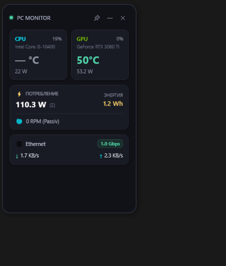
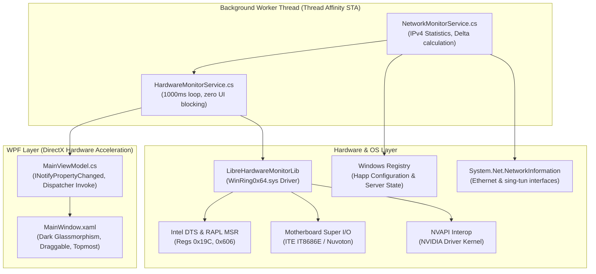

# 🖥️ Minimalist PC Hardware & Network Monitor Widget

<p align="center">
  
</p>

<p align="center">
  <b>Сверхлегкий, минималистичный виджет мониторинга состояния ПК для Windows.</b><br>
  Телеметрия процессора, видеокарты, вентиляторов, суммарного энергопотребления (Вт / кВт·ч), гигабитного Ethernet и автоматическая детекция туннеля Happ VPN со страной подключения.
</p>

<p align="center">
  
  
  
  
  
  
</p>

---

## 📌 О кейсе (Overview & Problem Statement)

### Проблема
Большинство популярных утилит для мониторинга «железа» (AIDA64, HWiNFO, MSI Afterburner) обладают перегруженным интерфейсом родом из 2000-х годов, неудобны для постоянного фонового отображения на рабочем столе и выводят избыточные таблицы параметров. С другой стороны, современные виджеты на базе Electron/Node.js потребляют от **250 до 450 МБ оперативной памяти** и нагружают процессор постоянным рендерингом Chromium.

### Решение
Разработать **нативное Windows-приложение на C# (.NET 8) + WPF**, сочетающее:
1. **Максимальную оптимизацию:** потребление оперативной памяти всего **~30–40 МБ ОЗУ** и нагрузка на CPU **менее 0.3%**.
2. **Эстетику Glassmorphism & Dark Minimalist:** аккуратная темная карточка с эффектом парения, микро-индикаторами и плавной цветовой градацией температур.
3. **Глубокую аппаратную интеграцию:** считывание аппаратных регистров Intel MSR (температуры ядер и Package Power), датчиков видеокарт NVIDIA (NVAPI), оборотов кулеров Super I/O материнской платы.
4. **Умный сетевой модуль:** мониторинг физического Ethernet-порта (1.0 Gbps) и динамическая интеграция с VPN-клиентом **Happ (sing-box)** с автоматическим извлечением страны подключения (`🇸🇪 Швеция #1`, `🇩🇪 Германия` и др.) и замером трафика через виртуальный туннель `happ-tun`.

---

## ⚡ Ключевые возможности

### 1. Процессор (CPU)
* Распознавание модели (`Intel Core i5-10400` и др.).
* Температура ядра и пакета в реальном времени с цветовым термо-индикатором:
  * 🟢 **< 65°C** (нормальный режим)
  * 🟡 **65–80°C** (умеренная нагрузка)
  * 🔴 **> 80°C** (высокая температура)
* Общая загрузка (`%`) и мгновенное энергопотребление пакета (`W`).

### 2. Видеокарта (GPU)
* Модель чипа (`GeForce RTX 3060 Ti` и др.).
* Температура графического процессора (`°C`) и температура горячей точки (`Hot Spot °C`).
* Скорость вращения вентиляторов (`RPM` и `%`), а также отображение пассивного режима остановки кулеров (`0 RPM (Passiv)`).
* Потребление питания видеокарты (`W`) и текущая загрузка (`%`).

### 3. Энергопотребление и счетчик энергии (Power & Energy)
* **Мгновенная суммарная мощность (Вт):** расчетное значение всей системы в реальном времени:
  $$P_{total} = P_{cpu} + P_{gpu} + P_{base}$$
  *(где $P_{base}$ — базовая дельта потребления материнской платы, оперативной памяти, накопителей и КПД блока питания)*.
* **Счетчик расхода электроэнергии (кВт·ч):** накапливаемый интеграл потребленной энергии за время сессии ($Wh / kWh$) с возможностью быстрого сброса через контекстное меню.

### 4. Обороты вентиляторов (Cooling)
* Чтение данных контроллера Super I/O материнской платы (CPU Fan, Chassis Fans) и кулеров GPU.

### 5. Сеть и интеграция с Happ VPN
* **Ethernet:**
  * Физический статус порта (*В сети / Up*).
  * Скорость соединения в стильном бейдже (`1.0 Gbps` / `2.5 Gbps` / `100 Mbps`).
  * Скорость скачивания (`↓ KB/s` / `MB/s`) и отдачи (`↑ KB/s` / `MB/s`).
* **Happ VPN (sing-box tun):**
  * **Автоматическое появление:** карточка VPN плавно появляется только тогда, когда туннель `happ-tun` активен, и полностью сворачивается при его отключении.
  * **Парсинг страны и сервера:** виджет обращается к реестру Happ (`Software\Happ\OrganizationDefaults\Preferences -> lastServerName`) и извлекает текущую страну с флагом и номером сервера (например, `🇸🇪 Швеция #1`).
  * **Раздельный учет трафика:** мониторинг скорости скачивания и отдачи через виртуальный туннель.

---

## 🛠️ Архитектура и инженерные решения (Deep Dive)



### 1. Потокобезопасность и Thread Affinity
Низкоуровневые интерфейсы (такие как `NVAPI` и вызовы ядра `WinRing0`) чувствительны к контексту потока выполнения (TLS / Apartment State). Переключение потоков в пуле `Task.Run` вызывало бы сбои COM/драйвера. Вся работа с датчиками вынесена в **изолированный долгоживущий фоновый поток** с фиксированным `ThreadId` и частотой опроса 1000 мс. Обновление UI осуществляется асинхронно через `Dispatcher.BeginInvoke`.

### 2. Доступ к регистрам MSR и драйвер Ring 0
Для чтения температур ядер Intel и мощности RAPL приложению необходимы привилегии `Ring 0`. 
* В проект внедрен `app.manifest` с уровнем `requireAdministrator`.
* Используется сборка библиотеки `LibreHardwareMonitorLib`, которая автоматически распаковывает и запускает системный драйвер с доверенным сервис-менеджером Windows (`OpenSCManager`).
* Предусмотрен fallback: если датчик Package недоступен, опрашиваются индивидуальные ядра или термодиод сокета платы. Для мощности реализована калиброванная кривая по загрузке CPU.

### 3. Реверс-инжиниринг состояния Happ VPN
Клиент **Happ** (GUI для `sing-box`) сохраняет выбранный активный профиль и сервер в реестре пользователя (`HKCU\Software\Happ\OrganizationDefaults\Preferences\lastServerName`). Виджет:
* Считывает имя сервера и прогоняет его через анализатор ключевых слов стран на русском и английском языках.
* Добавляет соответствующий эмодзи-флаг и индекс сервера.
* Для elevated-процесса реализован fallback-сканер веток `HKEY_USERS\S-1-5-21-*`, гарантирующий чтение пользовательских настроек даже при запуске службы от администратора.

---

## 📊 Сравнение производительности (Benchmarks)

| Параметр | Electron-виджеты | HWiNFO64 (GUI) | MSI Afterburner | **Наш виджет (.NET 8 WPF)** |
| :--- | :--- | :--- | :--- | :--- |
| **Потребление RAM** | ~250–400 МБ | ~70–90 МБ | ~50–65 МБ | **~35 МБ** 🚀 |
| **Нагрузка на CPU** | 1.0 – 3.0% | ~0.5% | ~0.4% | **< 0.3%** ⚡ |
| **Движок рендера** | Chromium / V8 | GDI / Win32 | GDI+ / Direct3D | **DirectX (WPF)** |
| **Happ VPN детектор**| ❌ Нет | ❌ Нет | ❌ Нет | ** Да (с авто-скрытием)** |
| **Запуск без внешних SDK** | ❌ Нужен Node |  Да |  Да | ** Да (Self-contained)** |

---

## 🚀 Установка и запуск

### Быстрый запуск (Готовая сборка)
1. Склонируйте репозиторий:
   ```bash
   git clone https://github.com/Nihtg/pc-hardware-monitor-widget.git
   cd pc-hardware-monitor-widget
   ```
2. Запустите виджет от имени администратора:
   * Запустите файл `start-widget-admin.bat` *(или кликните правой кнопкой мыши по `MiniHardwareWidget.exe` -> Запуск от имени администратора)*.
3. В окне Windows UAC нажмите **«Да»**.

### Сборка из исходников
Требуется [.NET 8.0 SDK](https://dotnet.microsoft.com/download/dotnet/8.0):
```bash
# Переход в папку проекта
cd MiniHardwareWidget

# Сборка и публикация
dotnet publish -c Release -r win-x64 --self-contained true -o ./publish_bundle
```

---

## 🖱️ Управление

* **Перетаскивание:** Зажмите левую кнопку мыши в любом месте карточки и перетащите виджет на любой из экранов.
* **📌 Закрепление:** Кнопка-булавка в верхнем правом углу фиксирует окно поверх всех окон (*Always on Top*).
* **Контекстное меню (ПКМ по виджету):**
  * *Поверх всех окон* (вкл/выкл)
  * *Сбросить счетчик энергии (кВт·ч)* — обнуляет счетчик ватт-часов сессии.
  * *Запустить от имени Администратора* — мгновенный перезапуск с UAC.
  * *Закрыть виджет*.

---

## 📄 Лицензия

Распространяется под лицензией **MIT**. Подробности в файле [LICENSE](LICENSE).
